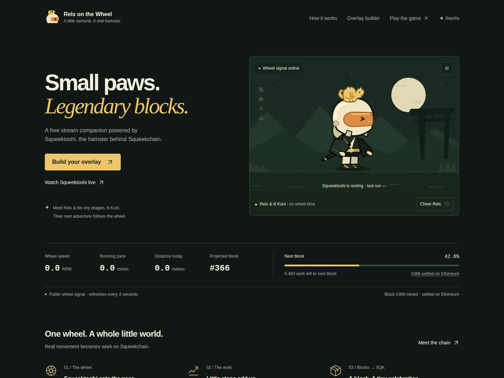
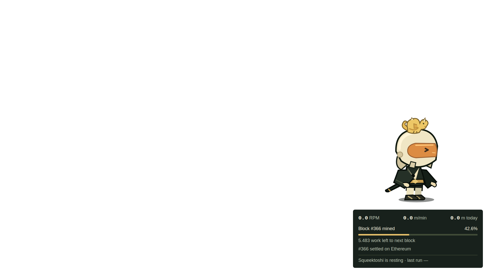

# Rels on the Wheel

A free live stream overlay, companion site, and just-for-fun prediction game for Squeekchain on Sepolia. Rels is an original chibi samurai, accompanied by a little yellow dragon, lil Kuni. Their inline SVG animation follows Squeektoshi’s real wheel signal.

**Built on Squeekchain · community project, not an official Squeekchain site**

## Run and rebuild

Use Node.js **22.18 or newer** and npm. No API key, wallet, account, or environment file is needed.

```sh
npm ci
npm run dev
```

For the finished static export:

```sh
npm run typecheck
npm test
npm run build
npm run preview
```

`dist/index.html`, `dist/overlay/index.html`, and every runtime asset are included with the source and lockfile. The build uses Vite + TypeScript with no runtime framework or dependencies. `scripts/export.mjs` creates the real static overlay route after Vite builds. Building does not require the API to be online.

To self-host, upload the **contents of `dist/`** to any HTTP(S) static host. Preserve the `assets/` and `overlay/` directories. Relative asset URLs support a gateway subpath as well as a domain root. No server rewrites, backend, service worker, trackers, external fonts, or remote artwork are required. Visit the hosted landing page to generate an overlay URL for that host and path; use the generated `/overlay/` URL, including its trailing slash. Serve through HTTP(S), rather than opening the HTML as a `file:` URL.

## Screenshots

These are browser captures of the actual production export. Displayed wheel values came from fresh public API responses, not test fixtures. The sandbox browser’s direct HTTPS transport failed; a **test-only curl transport bridge** supplied the real API responses for these captures. This bridge is absent from the site and export. See [validation and limitations](artifacts/validation.md).



[390px first screen](artifacts/screenshots/first-screen-390.png) · [Mobile landing page](artifacts/screenshots/landing-mobile.png)



The overlay image has an alpha background. Its empty area is deliberately transparent. This capture predates the overlay’s ground layers, added in the revision described under Checks, and has not been retaken.

## Add Rels to OBS

1. Open the landing page’s **Overlay builder**. Choose a corner, character size, HUD theme, HUD visibility, sound, and optional streamer name. The sample stream is labeled as a preview; its Rels scene uses the same real signal as the hero and game.
2. Select **Copy OBS URL**. If clipboard permission is unavailable, the complete URL is selected for manual copying.
3. In OBS, go to **Sources → + → Browser** and create a Browser Source.
4. Paste the copied URL. Set **Width 1920 / Height 1080**, or **1280 / 720** for a 720p scene. The overlay background is already transparent.
5. Leave “Shutdown source when not visible” off to preserve the session. Sound is off by default. With sound enabled, allow Browser Source autoplay if your OBS/browser policy blocks it. Ordinary browsers may require a gesture before Web Audio can play; the animation works without audio.

### Overlay URL options

| Parameter | Accepted values | Default |
| --- | --- | --- |
| `pos` | `bottom-left`, `bottom-right`, `top-left`, `top-right` | `bottom-right` |
| `scale` | Number from `0.5` through `2` | `1` |
| `hud` | `0` hides the HUD; `1` shows it | `1` |
| `sound` | `0` silent; `1` synthesized block ding | `0` |
| `theme` | `dark`, `light` (HUD only) | `dark` |
| `name` | Plain text on the block banner, up to 40 characters | Empty |

Invalid values fall back safely. Control characters are removed from names, which are URL encoded and inserted as text. The standalone overlay fits the requested scale within its viewport if needed, so `scale=2` cannot push a HUD out of a 720p frame. The preview represents a 1920 × 1080 stream. No click is needed to start the overlay.

## Real data and its limits

The sole runtime data endpoint is [`GET https://api.squeekchain.com/v1/status`](https://api.squeekchain.com/v1/status). [Official API documentation](https://docs.squeekchain.com/developers/api/) describes its wire contract. The code accepts **schemaVersion 1**, ignores fields it does not use, and rejects unsupported versions or malformed required values.

| API field | Use |
| --- | --- |
| `schemaVersion`, response `status`, `builder.status` | Version and availability checks |
| `measurement.coreStatus` | Running, resting, or wheel-counter fault pose |
| `measurement.freshness` | Online or stale signal state |
| `measurement.rpmMilli` | RPM (`/ 1000`), smoothed/clamped run cadence, tail, ground parallax |
| `measurement.speedMmPerSecond` | Metres per minute (`× 60 / 1000`) |
| `measurement.distanceMm` | Today’s metres (`/ 1000`) |
| `measurement.observedAt` | Validates the observation timestamp; freshness comes from the API |
| `builder.projected.blockHeight` | Optimistic “Block #N mined” frontier, celebrations, game settlement |
| `builder.projected.blockProgress` | Next-block fraction (`/ 1,000,000,000`), displayed as a percent |
| `builder.projected.workPerThousandBlocks` | Work per block (`/ 1000`), multiplied by the remaining fraction for work left |
| `builder.anchor.blockHeight` | Height already settled on Ethereum, separate from the projection |
| `builder.anchor.transactionHash` | Sepolia Etherscan settlement receipt, only when a valid hash exists |

All decimal quantities are normalized to `BigInt`, including the documented safe-integer measurement fields. Formatting and work arithmetic retain integer precision; only the bounded animation speed and final CSS percent become display values. For example, progress `425653103` means **42.6%**, not 425.7%.

One shared poller serves the whole page, including all three mascots, HUDs, builder preview, and game. It requests every 3 seconds, returns the last ETag unchanged in `If-None-Match`, and reuses a 304 response’s cached snapshot. Requests do not overlap. HTTP 429/503 waits the full `Retry-After` and then exponential backoff; other failures also back off, capped at 60 seconds. Hidden tabs stop requests and animation; returning to the tab preserves any remaining retry delay.

Loading or missing readings show **—**, never an invented zero. An unavailable response/builder, failed request, malformed payload, or unsupported schema shows **Signal lost** and retains the last good values in muted grey. A stale measurement keeps its distinct stale label and searching pose. Stale and Signal lost outrank every core status, including a counter fault: the helmet-scratch pose and “wheel hiccup” label appear only for a current, online reading.

Resting is normal. After more than 20 seconds of observed IDLE, Rels sits and nods off, Kuni curls up, and sleepy letters appear. “Last run” is the last ACTIVE state observed **during this session**, or **—** if none has been seen. Projected blocks are optimistic: Ethereum settlement and SQK checkpointing are separate stages. The footer and share metadata explicitly identify this as an independent community project.

A new projected height queues at most three 2.8-second slash celebrations from a burst, each with a gold streak, spinning Kuni, confetti, and optional synthesized Web Audio ding. The first snapshot sets a baseline and never invents a celebration. There is no production demo mode or random data generator.

## Beat the Wheel

Choose **Under 10 min**, **10–30 min**, **30–60 min**, or **Over 1 h**, then lock in one guess. The clock starts when you lock it. A higher projected block height settles the guess, even if several blocks arrive together. Rels reacts in the game itself after the slash celebration, and the result is also written as text.

Windows use half-open boundaries: below 10 minutes, 10 to below 30, 30 to below 60, and 60 minutes onward. Timing uses **this page’s detection time**, not a claim about the exact mining instant. Offline or hidden intervals can therefore affect the result. A pending guess remains in memory only and resets on reload; current and best streaks use `localStorage` behind `try/catch`, with an in-memory fallback if storage is blocked. No shared leaderboard, prizes, money, wallet, or transactions are involved. **Cheer Rels** is a local bow and sends nothing to Squeekchain.

## Checks

```sh
npm run typecheck
npm test
npm run build
npx playwright install chromium webkit
npm run test:browser
```

The browser script serves the actual `dist/` beneath `/preview/` in one bounded foreground process. Its deterministic fixtures live only in the test script, to exercise running, sleeping, faults, availability, block bursts, game outcomes, retries, and conditional requests. It also tries the real API separately. The optional `RELS_TEST_TOOLS`, `RELS_CHROMIUM`, and `RELS_WEBKIT` test arguments are environment variables for isolated test tooling; the application reads no environment configuration.

Worker results on 2026-11-05: production build and typecheck passed; **14 unit tests passed**; **18 browser-check groups passed**, including the real-response bridge, with the two environment limitations below; WCAG-tagged axe checks passed. The pinned taste probe passed **15 of 16** checks. Its single repetition flag is the required “work left to next block” label appearing in both the live dashboard and the builder’s live HUD preview. WebKit could not launch with this host’s available native libraries; Safari, physical OBS, hardware frame rate, screen-reader sessions, and browser-native 200% zoom remain unverified. Direct API transport in the sandbox browser failed, while actual API GET and CORS preflight succeeded via curl. These are worker-reported checks, not independent certification.

**Those results predate the latest revision and were not repeated for it.** The revision adds the overlay’s ground layers and makes stale/lost outrank a counter fault. No shell or browser could start in that session, so the build, typecheck, unit tests, browser checks, and taste probe did not run, and the new `tests/scene.test.ts` and updated `tests/browser.mjs` steps have never been executed. The same changes were applied to `dist/assets/` by hand rather than by `npm run build`, so the asset filenames no longer reflect their content hashes. Run the commands above to confirm the revision and regenerate the export. See [validation](artifacts/validation.md).

See [full validation](artifacts/validation.md) for coverage and fixes, and [DESIGN.md](DESIGN.md) for implemented tokens and components. Design guidance attribution is retained in [third-party notices](artifacts/THIRD_PARTY_NOTICES.txt).
